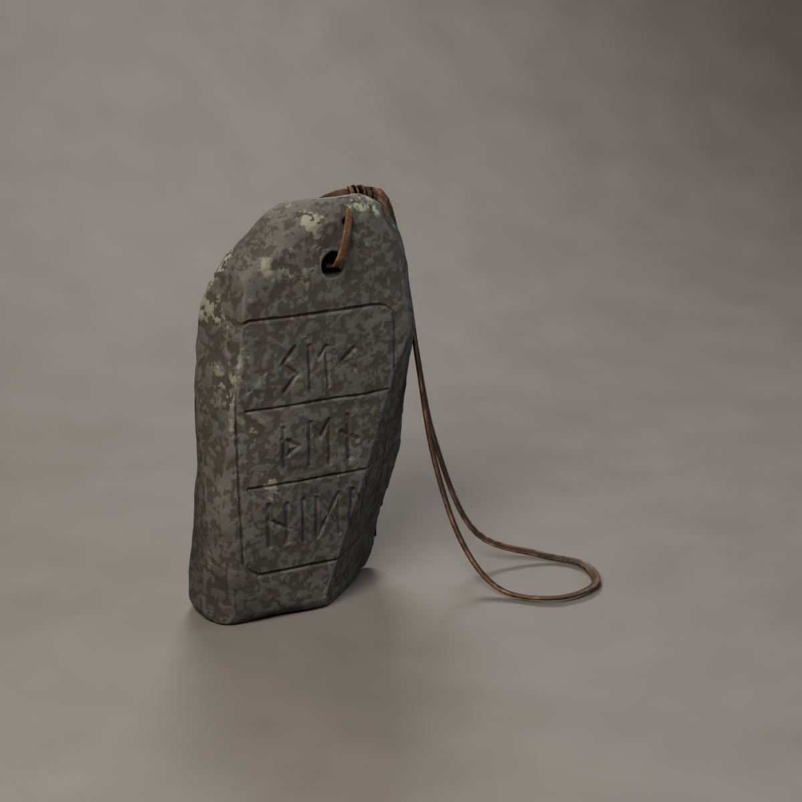
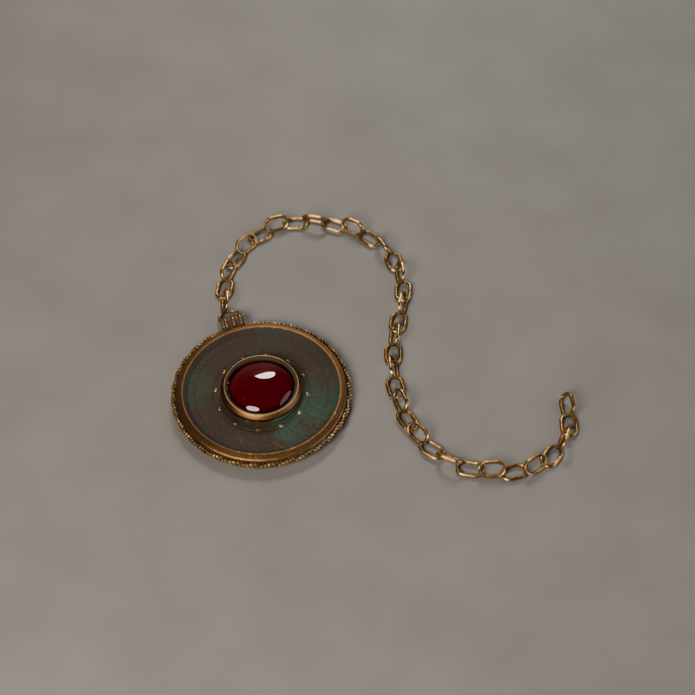
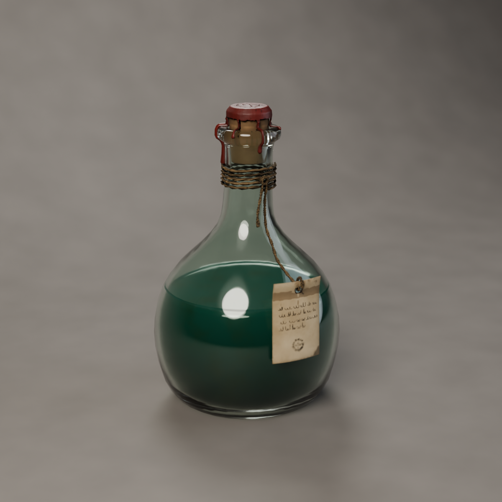
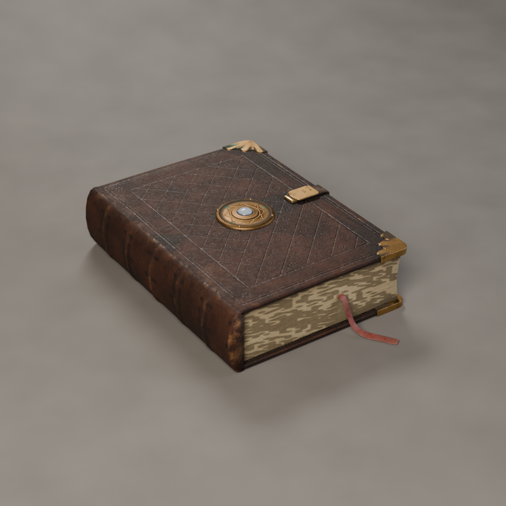
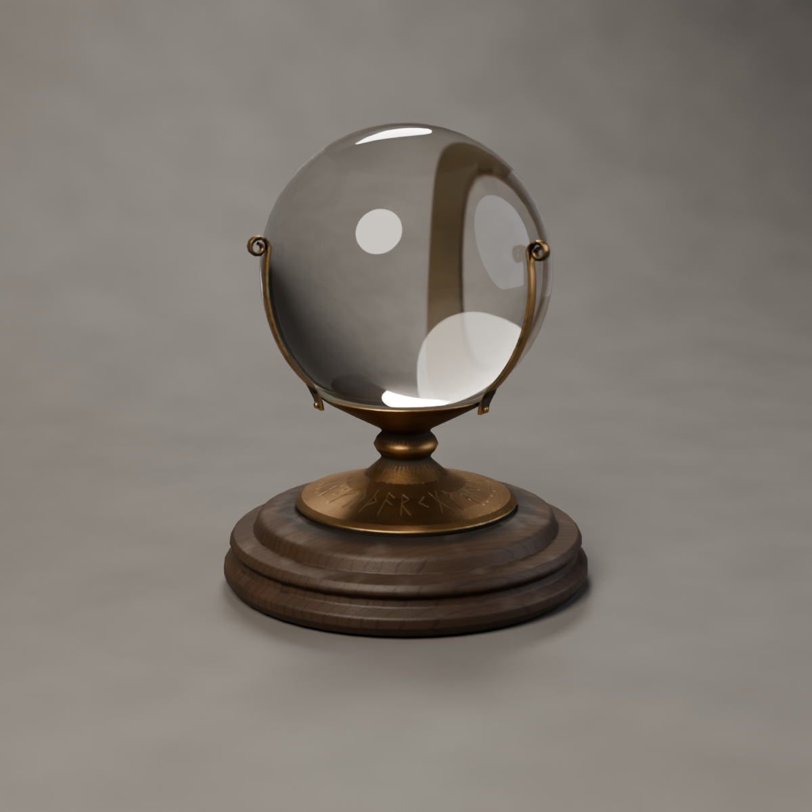
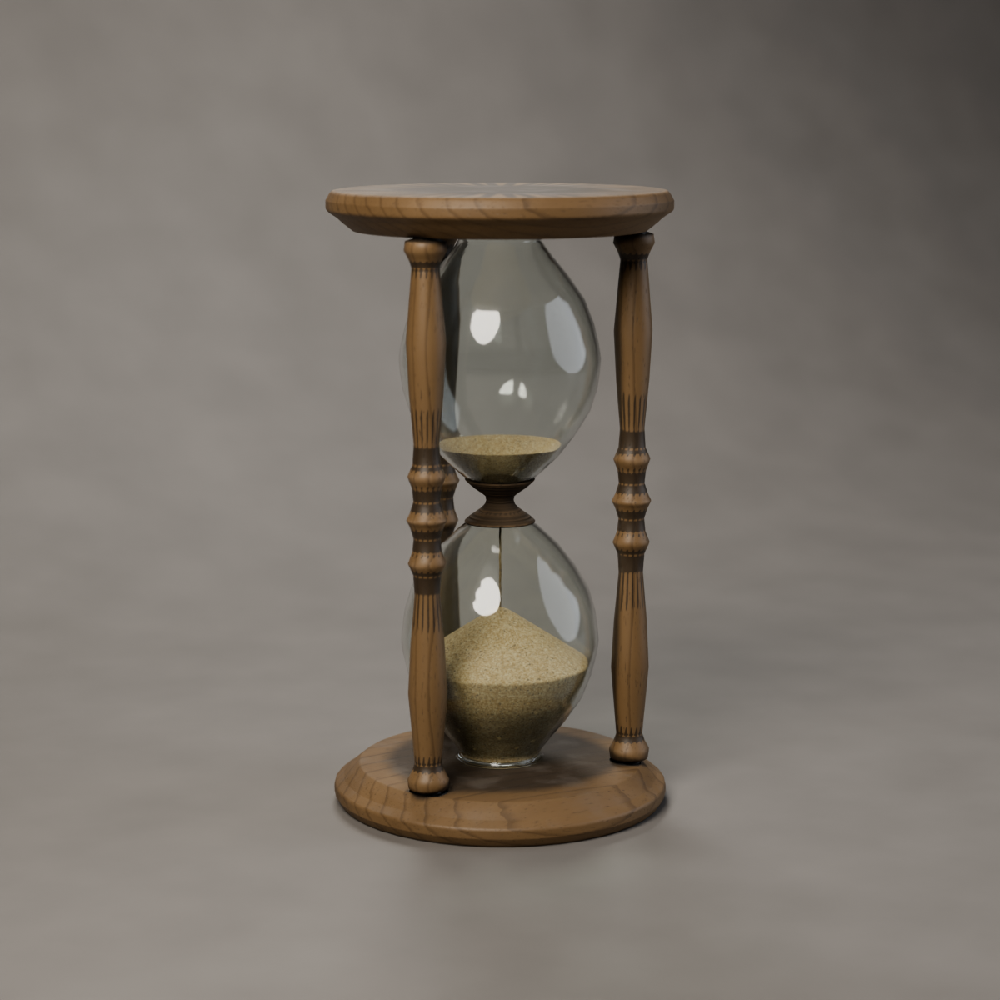

# SeekThenHide — Mistik Eşyalar (Blender ile yeniden yapım)

Altı mistik eşyanın tamamı Blender'da (5.2 LTS, `bpy`) prosedürel olarak modellendi,
yüksek detaylı kaynak modelden oyun modeline bake edildi ve oyun motoruna hazır
biçimde dışa aktarıldı. Hiçbir aşamada üretken bir 3B/görsel model kullanılmadı;
her şey `tools/` altındaki betiklerden yeniden üretilebilir.

## Eşyalar

| | Eşya | Gerçek boyut | Oyun modeli (üçgen) | Doku | Ayrıntılar |
|---|---|---|---|---|---|
|  | **Rün Taşı** `RuneStone` | 13 × 4.5 × 21 cm | 7.672 | 2048² | Grovak levha, kırık/çentikli kenarlar; ön yüzde çerçeveli üç satır Elder Futhark (*s-e-k : þ-e-n : h-i-d-e*), arkada çember içinde *algiz*. Oyuklarda solmuş kırmızı aşı boyası, üst yüzlerde liken, iki yandan delinmiş delikten geçen deri bağcık ve sargı. |
|  | **Muska** `Amulet` | Ø 4.5 cm + 20 cm zincir | 8.268 | 1024² | Dökme bronz brakteat: kıvrık yuvaya oturmuş garnet kabaşon, 12 granül, burgulu tel kenar, çevrede kazınmış *alu / laþu*, oluklu asma halkası, yere düşmüş gibi duran ince zincir. Taşta parıltı maskesi. |
|  | **İksir Şişesi** `Potion` | Ø 9 × 14 cm | 8.492 + 4.224 cam | 2048² | Üflenmiş şişe (eğik boyun, iç bükey dip), mantar tıpa, üstü damgalı kırmızı mühür mumu ve boyuna akan damlalar, iki katlı sicim sargısı, mürekkeple yazılmış lekeli etiket. Bulanık sıvıda hafif parıltı maskesi. |
|  | **Kadim Kitap** `Grimoire` | 18 × 24 × 6 cm | 8.790 | 2048² | Kör baskı baklava desenli deri cilt, beş kabartma bantlı yuvarlak sırt, oymalı pirinç köşelikler ve perçinler, kabartma yıldızlı pirinç göbekte aytaşı, kayış kilit, kesim kenarında yaprak çizgileri, solmuş ipek kurdele. |
|  | **Kehanet Küresi** `ScryingOrb` | Ø 14 × 17.6 cm | 9.600 + 2.208 cam | 2048² | Kaya kristali küre; ayağında tam futhark dizisi kazınmış döküm pirinç taşıyıcı, ucu kıvrık üç tırnak ve perçinler, tornada çekilmiş ceviz kaide, altında keçe. |
|  | **Kum Saati** `Hourglass` | Ø 10.5 × 19 cm | 9.984 + 5.760 cam | 2048² | Meşe tablalar ve üç torna dikme, üflenmiş çift hazne, belinde mumlu keten bağ; kumun çoğu akmış (33° yığılma açısı), ince kum akışı. Seyrek kum tanelerinde parıltı maskesi. |

"cam" alt nesnesi (`SM_<Eşya>_Glass`) dokusuzdur; motorda saydam bir malzeme verilmesi
beklenir. Yüksek detaylı kaynak modeller (75 bin – 360 bin üçgen) depoya konmadı, betik
her çalıştığında yeniden üretiyor.

## Bilinen eksikler

- `RuneStone` ve `Grimoire` dosyaları, `tools/mi_materials.py` içindeki son düzeltmeden
  (taş yüzeyi ve sayfa kenarı ayrıntısının doku çözünürlüğüne göre sınırlanması) **önce**
  üretildi. Bu yüzden oyun modellerinde taş yüzeyinde ve sayfa kenarlarında hafif lekeli
  (aliasing) bir desen var. Düzeltmek için:
  `python tools/build_mystic_items.py --items RuneStone,Grimoire`
- Toplu görsel (`Previews/Lineup.png`) henüz render edilmedi: `python tools/render_lineup.py`

## Neden "yapay zekâ işi" gibi durmuyorlar

- **Gerçek ölçü ve üretim mantığı.** Her parça, gerçekte nasıl yapıldıysa öyle kuruldu:
  tornada çekilmiş ahşap profiller, dökme pirinç ayak, üflenmiş şişe (hafif eğik boyun,
  dipte iç bükey "punt"), bükülmüş tel, iki taraftan delinip ortada buluşan taş deliği,
  tahta kapaklı ve kabartma bantlı cilt. Ölçüler metre cinsinden, gerçek boyutta.
- **Aşınma geometriden geliyor, rastgele lekelerden değil.** Yüksek detaylı modelin kendi
  gölgelenmesi (AO) ve kenar eğriliği okunuyor: kirin ve pasın (verdigris) girintilerde,
  parlamanın ve deri aşınmasının ele gelen kenarlarda birikmesi bundan.
- **Tarihsel referanslar.** Rün taşındaki yazı Elder Futhark ile `s-e-k : þ-e-n : h-i-d-e`
  (*seek then hide*) ve oyuklarda solmuş kırmızı aşı boyası kalıntısı var (Viking dönemi
  taşları boyanırdı). Muskada göç dönemi brakteatlarındaki *alu* / *laþu* tılsım sözcükleri,
  granülasyon ve burgulu tel; kürenin pirinç ayağında Kylver taşındaki gibi tam futhark
  dizisi; kitapta kör baskı (blind tooling) baklava deseni ve pirinç köşelikler.
- **Ölçülü palet.** Doygun neon renkler ve her yerden fışkıran parıltı yok. "Mistik" etki
  sadece ayrı bir *Emissive* haritasında (taş, sıvı, kum); motor tarafında oyunun
  ihtiyacına göre açılıp kısılabilir.
- **Kusurlar.** El işi asimetri, eğrilmiş kapak, çentikli taş kenarı, kopmuş-yıpranmış
  kurdele ucu, damlamış mühür mumu, etikette mürekkeple yazılmış satırlar.

## Klasör yapısı

```
MysticItems/
  Export/FBX/SM_<Eşya>.fbx     Unity / Unreal için (cam ayrı alt nesne: SM_<Eşya>_Glass)
  Export/GLB/SM_<Eşya>.glb     Godot, Unity (glTFast), web — dokular gömülü
  Textures/<Eşya>/             T_<Eşya>_BaseColor / _Normal / _ORM / _MaskMap / (_Emissive)
  Blend/<Eşya>.blend           oyun modeli + malzemeler + önizleme ışığı
  Previews/<Eşya>.png          oyun modelinin (bake edilmiş haliyle) Cycles render'ı
  tools/                       üretim betikleri
```

## Doku kanalları

| Dosya | İçerik | Kullanım |
|---|---|---|
| `_BaseColor` | sRGB albedo | hepsi |
| `_Normal` | tangent-space, **OpenGL (Y+)** | Unity, Godot, Blender. Unreal'da dokunun *Flip Green Channel* ayarını açın |
| `_ORM` | R = AO, G = Roughness, B = Metallic | Unreal, Godot, glTF |
| `_MaskMap` | R = Metallic, G = AO, B = 0, A = Smoothness | Unity HDRP *Mask Map*; URP'de *Metallic Map* (R/A) ve *Occlusion* (G) olarak |
| `_Emissive` | parıltı maskesi (renkli) | sadece Muska, İksir, Kitap ve Kum Saati'nde |

Rün taşında bilinçli olarak parıltı yok. Parlayan rün isterseniz `tools/mi_materials.py`
içindeki `stone()` malzemesinde oyuk maskesini (`g`) emisyona bağlayıp eşyayı yeniden üretmeniz
yeterli; maske zaten orada.

## Motorlara alma

- **Unity:** FBX'i sürükleyin, Scale Factor 1. URP/Lit: BaseColor → *Base Map*, MaskMap →
  *Metallic Map* (Source: Metallic Alpha), Normal → *Normal Map*. Cam alt nesnesine
  saydam bir Lit malzeme verin (Surface Type: Transparent).
- **Unreal:** FBX import, "Import Normals" açık. Normal dokusunda *Flip Green Channel*,
  ORM dokusunda sRGB kapalı.
- **Godot 4:** GLB doğrudan; malzemeler ve ORM otomatik bağlanır.

Pivot her eşyada zemin hizasında, eşyanın ortasında; birim metre, Z yukarı (FBX/GLB
dışa aktarımında motorların Y-yukarı eksenine çevrilir).

## Yeniden üretmek

```bash
python3.13 -m venv .venv && .venv/bin/pip install bpy==5.2.3
.venv/bin/python MysticItems/tools/build_mystic_items.py                 # hepsi, son kalite
.venv/bin/python MysticItems/tools/build_mystic_items.py --items Amulet  # tek eşya
.venv/bin/python MysticItems/tools/build_mystic_items.py --items Potion --look --preview 700 --samples 48
.venv/bin/python MysticItems/tools/render_lineup.py
```

Ya da Blender içinden: `blender -b --python MysticItems/tools/build_mystic_items.py -- --items Hourglass`.

| Betik | Ne yapar |
|---|---|
| `mi_core.py` | geometri yardımcıları (torna, süpürme, burgu), maske çizimi (rün, el yazısı), bake ve dışa aktarma |
| `mi_materials.py` | prosedürel malzemeler: eskimiş pirinç/bronz, ceviz/meşe, deri, taş, mantar, mum, parşömen, kum, cam… |
| `mi_items.py` | altı eşyanın modeli; her biri aynı koddan hem `hp` (kaynak) hem `lp` (oyun) çıkarır |
| `build_mystic_items.py` | hp → lp bake, doku paketleme, FBX/GLB, önizleme, .blend |
| `render_lineup.py` | toplu gerçek ölçek görseli |
