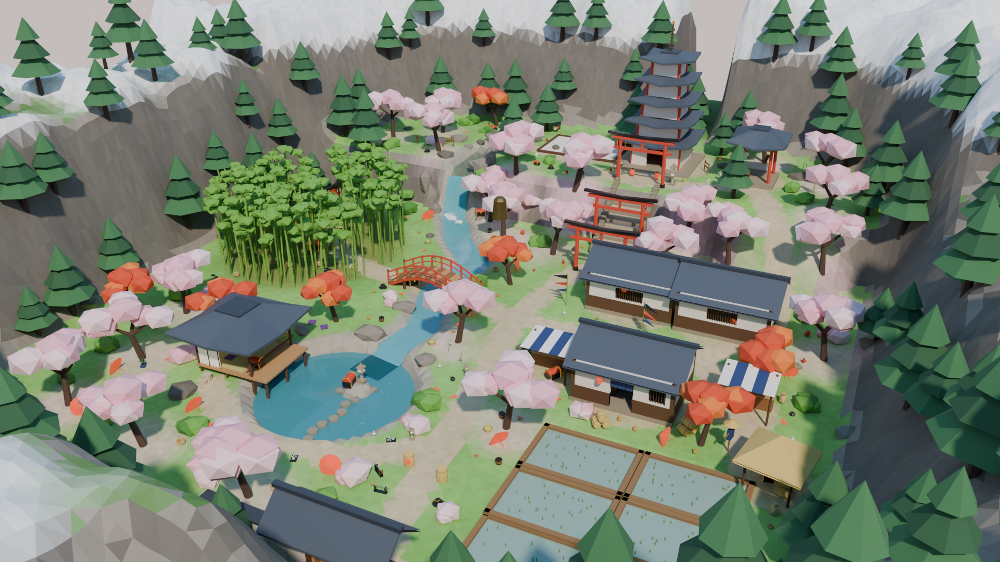
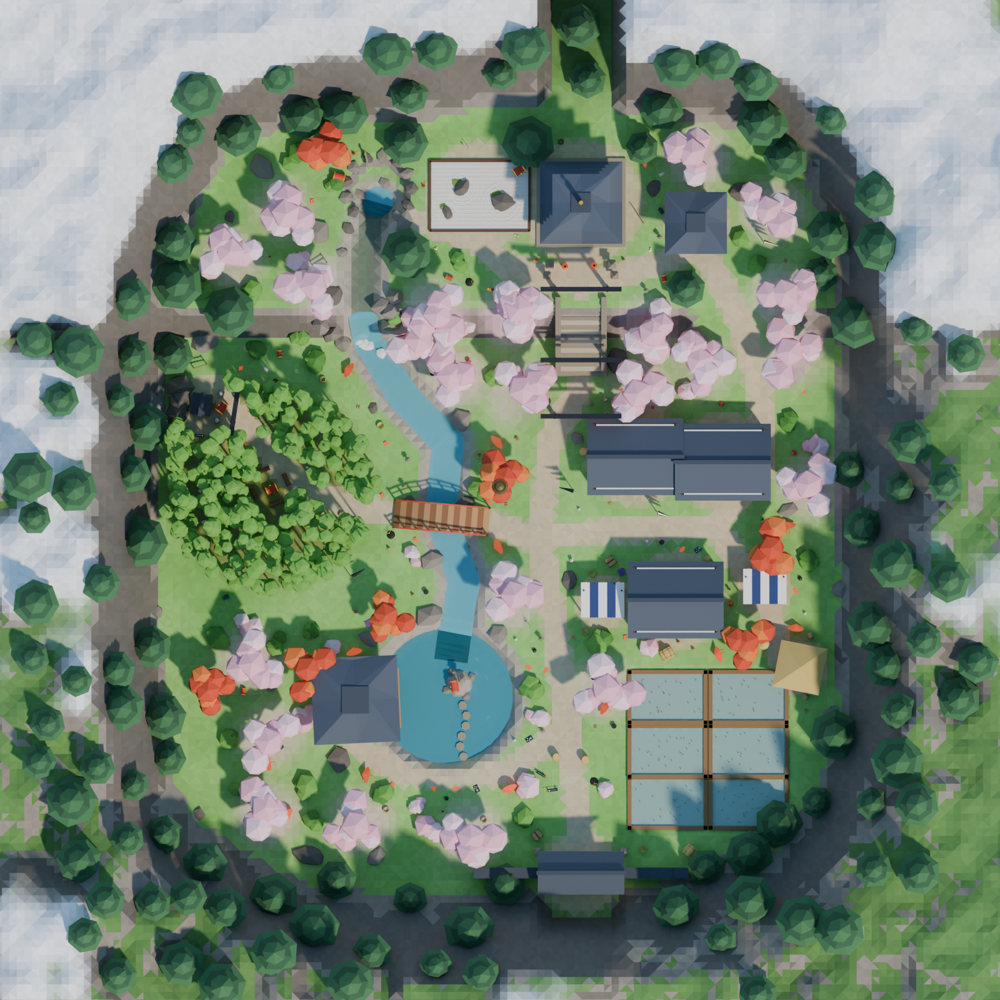
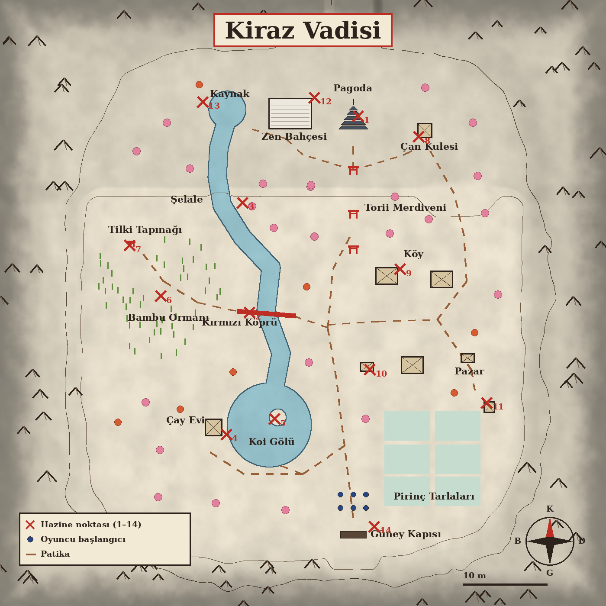
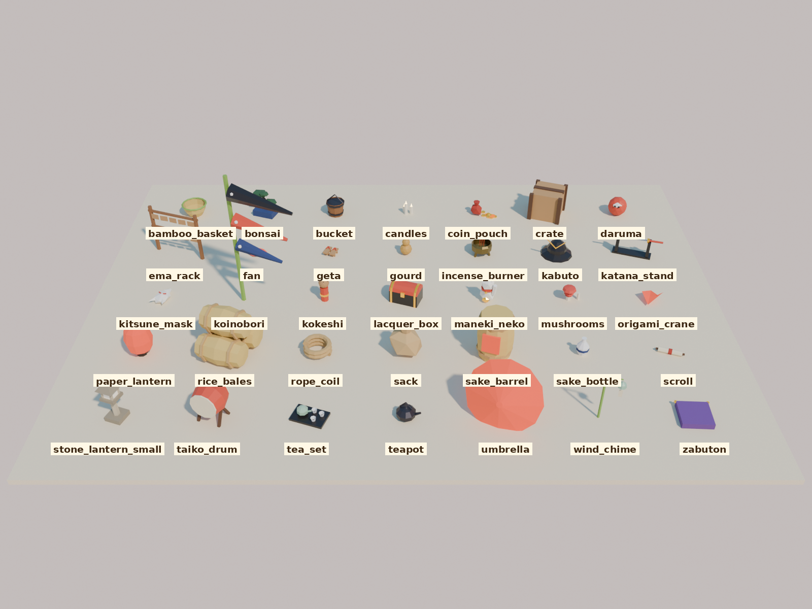

# Kiraz Vadisi — SeekThenHide

Hazine avı için ikinci küçük harita: ilkbaharda, çam ağaçlı dağlarla çevrili, yaklaşık
50 × 60 m'lik bir Japon vadisi. Kayıp Korsan Koyu ile aynı amaç ve aynı düzen (hazine
noktaları, oyuncu başlangıçları, 200 eşya); ama sınırı deniz değil dağ duvarları.
Her şey `build_blossom_valley.py` ile Blender içinde üretilir ve
`../treasure_cove/build_treasure_cove.py` araç setini kullanır.



| Tepeden | Harita |
| --- | --- |
|  |  |

## Dosyalar

| Dosya | Ne işe yarar |
| --- | --- |
| `export/blossom_valley.glb` | Oyuna atılacak dosya (arazi, sular, yapılar, bitki örtüsü, spawn noktaları, eşyalar) |
| `blossom_valley.blend` | Düzenlenebilir sahne; ışıklar ve kameralar `Preview_Rig` koleksiyonunda |
| `renders/valley_map.png` | Washi kâğıdı üzerine mürekkep tarzı yerleşim haritası (numaralı hazine noktaları, patikalar) |
| `renders/valley_props_map.png` | Aynı harita, 200 eşyanın yerleriyle |
| `renders/props_catalog.png` | Bütün eşya çeşitleri yan yana, isimleriyle |
| `renders/valley_*.png` | Önizlemeler: genel görünüm, teras, göl, köy, tepeden |

## Vadi

Oyuncular güneydeki **kapıdan** girer. Ana yol köyün yanından geçip torii merdiveninden
kuzeydeki terasa çıkar; doğudaki köy sokağı da hafif bir rampayla terasa bağlanır.

- **Teras ve pagoda (kuzey, +5 m):** beş katlı pagoda; zemin katı açık, içinde sunak var.
  Önünde taş fenerler, yanında çan kulesi (bronz çan ve tokmak kütüğü), tırmıklanmış
  çakıllı ve kayalı bir zen bahçesi ve bambu oluklu kaynak havuzu.
- **Torii merdiveni:** vadiden terasa çıkan taş merdiven; üzerinde üç kırmızı torii
  kapısı, iki yanında taş fenerler.
- **Şelale ve dere:** terastaki kaynaktan doğan dere teras kenarından şelale olarak
  düşer, vadide kıvrılarak koi gölüne akar.
- **Kırmızı köprü:** derenin üstünde kemerli, korkuluklu bir köprü; altından geçilebilir.
- **Koi gölü (güneybatı):** sazan balıkları, basamak taşlarıyla gidilen fenerli bir
  adacık ve göle uzanan, tatami zeminli, shoji duvarlı çay evi.
- **Köy (doğu):** beyaz sıvalı, kiremit çatılı üç ev (kapılarında noren perdesi ve kırmızı
  fener); çizgili tenteli iki pazar tezgâhı.
- **Pirinç tarlaları (güneydoğu):** altı sulu tarla, aralarında set yolları; saman çatılı
  bir tarla kulübesi ve korkuluk.
- **Bambu ormanı (batı):** sık bambu; ortasında kütük oturaklı küçük bir açıklık.
- **Tilki tapınağı (batı, uçurum dibi):** kaya önünde küçük bir tapınak, torii ve iki
  tilki heykeli.
- Kiraz ve akçaağaç ağaçları, çalılar (bir kısmı pembe açelya), kayalar; dağlarda karlı
  tepeler ve çam ağaçları.

## Hazine noktaları

Her `TreasureSpawn_##` boş nesnesinin altında siyah lake, altın köşeli bir
`TreasureChest_##` sandığı vardır.

| # | Yer |
| --- | --- |
| 1 | Pagodanın zemin katı |
| 2 | Kırmızı köprünün altı |
| 3 | Şelalenin dibi |
| 4 | Çay evinin verandası |
| 5 | Göldeki fenerli adacık |
| 6 | Bambu ormanındaki açıklık |
| 7 | Tilki tapınağı |
| 8 | Çan kulesi |
| 9 | Köy evi (içeride) |
| 10 | Pazar tezgâhı (tezgâhın arkası) |
| 11 | Tarla kulübesi |
| 12 | Zen bahçesi |
| 13 | Terastaki kaynak |
| 14 | Güney kapısı (iç taraf) |

`PlayerSpawn_01..06` güney kapısının iç tarafında, iki sıra hâlinde, yüzleri kuzeye dönük.

## Hazine olabilecek 200 eşya

Her biri ayrı bir nesne (`Prop_001_<çeşit>` … `Prop_200_<çeşit>`):



| Bölge | Adet | Eşyalar |
| --- | --- | --- |
| Teras | 26 | taş fener, tütsülük, ema dilek tahtaları, bonsai, parşömen, mumlar, rüzgâr çanı, tilki maskesi, kabuto miğferi, taiko davulu, origami turna, kese, lake kutu |
| Merdiven başı ve dibi | 8 | taş fener, kâğıt fener, origami turna, kese, tilki maskesi |
| Köy | 26 | sake fıçısı, pirinç balyaları, kasa, çuval, kova, şemsiye, geta, maneki-neko, daruma, kokeshi, çay takımı, minder, kâğıt fener, koinobori, sepet, sake şişesi |
| Pazar | 12 | sepet, sake şişesi, demlik, daruma, kokeshi, yelpaze, su kabağı, kasa, çuval, şemsiye, maneki-neko |
| Dere kıyısı | 18 | kova, su kabağı, halat, şemsiye, geta, yelpaze, origami turna, sepet, taş fener |
| Göl ve çay evi çevresi | 20 | çay takımı, demlik, minder, yelpaze, şemsiye, origami turna, taş fener, sake şişesi, rüzgâr çanı |
| Bambu ormanı | 18 | sepet, mantarlar, tilki maskesi, katana sehpası, su kabağı, çuval, sake şişesi, halat |
| Tilki tapınağı | 8 | tilki maskesi, ema tahtaları, mumlar, tütsülük, sake şişesi, kese, origami turna |
| Pirinç tarlaları | 16 | pirinç balyaları, sepet, kova, çuval, şemsiye, su kabağı, geta |
| Güney kapısı | 8 | katana sehpası, kabuto, kâğıt fener, kasa, sake fıçısı, şemsiye |
| Çayırlar | 40 | mantarlar, daruma, su kabağı, şemsiye, geta, yelpaze, sake şişesi, origami turna, halat, kokeshi, lake kutu, bonsai, kese, kabuto, koinobori |

Eşyalar sulara, merdivene, yapılara, ağaçlara, patikalara ve spawn noktalarına girmeyecek
şekilde yerleştirilir. Aynı çeşitteki eşyalar tek bir mesh'i paylaşır.

## Motor notları

- Birim metre, glTF'de +Y yukarı. Kuzey Blender'da +Y, glTF'de -Z.
- `extras` alanları Kayıp Korsan Koyu ile aynı: boş nesnelerde `kind` (`treasure_spawn`,
  `player_spawn`), `index`, `label`; sandıklarda `kind = treasure_chest`; eşyalarda
  `kind = treasure_prop`, `item`, `zone`, `index` (1–200).
- `Terrain` renklerini köşe rengi (`COLOR_0`) olarak taşır. Dağ duvarları dik ve yüksek;
  oyun alanı yaklaşık x ∈ [-25, 25], y ∈ [-28, 27]. Güney kapısının kanatları kapalı.
- `Water` nesnesi (dere, şelale, kaynak, göl, tarlalar) ve `Waterfall_Foam` için çarpışmayı
  kapatın; göl en derin yerde ~0,9 m, dere ~0,5 m.
- Taş fenerlerin ışık kutuları, shoji paneller ve kâğıt fenerler hafif emissive; bloom
  açıkken en iyi görünür.

## Yeniden üretmek

```
blender --background --python build_blossom_valley.py
blender --background --python build_blossom_valley.py -- --fast
blender --background --python build_blossom_valley.py -- --no-render
```

Harita görselleri için Pillow gerekir; yoksa o adım atlanır.
