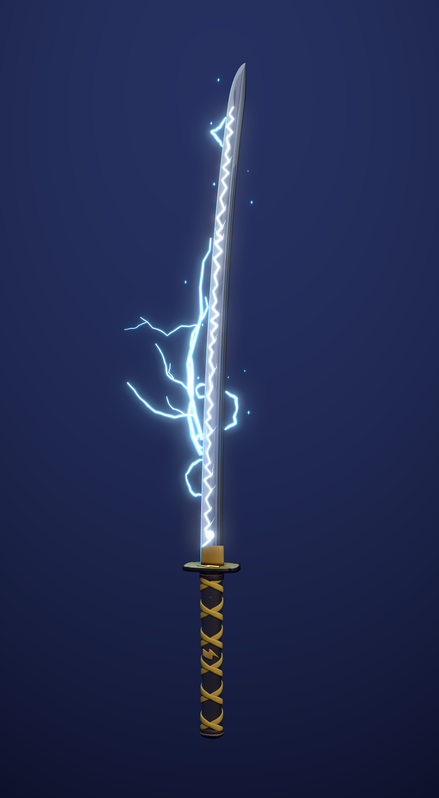

# Yıldırım Katana — SeekThenHide

Mavi-beyaz yıldırım katanasının detaylı versiyonu. Mistik katanayla aynı araç
setini (`../mystic_katana/build_mystic_katana.py`) kullanır; model, dokular, efektler
ve animasyon `build_lightning_katana.py` ile Blender içinde üretilir.



## Dosyalar

| Dosya | Ne işe yarar |
| --- | --- |
| `export/lightning_katana.glb` | Oyuna atılacak dosya (dokular gömülü, `LightningLoop` animasyonu) |
| `lightning_katana.blend` | Düzenlenebilir sahne; dokular dosyanın içine paketli |
| `textures/` | Namlu (512×4096) ve kabza atlası (2048²) |
| `renders/` | Önizlemeler, `katana_lightning_loop.mp4` yıldırım videosu |

## Blender'da oynatma

`lightning_katana.blend`'i açın, 3D görünümde **Z → Material Preview** (ya da bloom ile
**Rendered**) seçin ve **Space**'e basın. Zaman çizelgesi 1–72 kare (24 fps) döngüdür.

## Tasarım

- **Namlu:** buz mavisi çelik; hamon gerçek "inazuma" (yıldırım) tipinde, keskin
  zikzak ve köşelerden ayrılan çatallar, kenar tarafı buz beyazı, ji'de fırtına bulutu
  lekeleri. Taban üstünde elle çizilmiş mitsudomoe (Raijin davulu) arması. Zikzak,
  arma ve kenar çizgisi emission dokusunda parlar.
- **Kabza:** altın muhafız, üst ve alt yüzünde kabartma yıldırım şekilleri, kalın koyu
  konturlar ve eğe çentikleri; altın habaki; siyah samegawa üzerinde altın ipek sargı;
  yıldırım menuki; koyu demir fuchi/kashira.
- **Yıldırım efekti:** hiçbiri silindir/çizgi primitifi değil. Her şimşek orta nokta
  kaydırmalı köşeli bir yoldan çizilmiş, tabanda kalın, uca doğru incelen, dallanan üç
  tonlu (camgöbeği / açık mavi / beyaz çekirdek) düz bir fırça darbesi. Ana deşarjlar
  namlu boyunca sürünür, kısa arklar kenardan sıçrar, kıvılcımlar çakar.
- **Animasyon:** 8 farklı yıldırım çizimi düzensiz bir ritimle (1–3 kare) değişir,
  arada kısa karanlık anlar olur; namlunun parlaması her çakışta yükselip arada söner.
  glb'de tek klip (`LightningLoop`, STEP), parlama `KHR_animation_pointer` ile.

## Motor notları

Orijin sapın ortasında, glTF'de kılıç +Y yönünde. `FX_Lightning_*` ve
`Katana_InkOutline` için gölge düşürmeyi kapatın; bloom açık olursa en iyi görünür.

## Yeniden üretmek

```
blender --background --python build_lightning_katana.py
blender --background --python build_lightning_katana.py -- --fast
```
