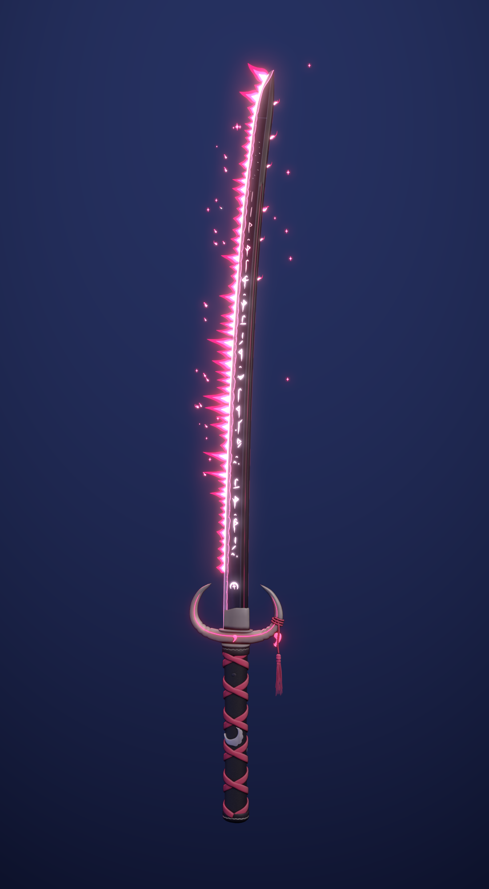

# Mistik Katana — SeekThenHide

Mevcut pembe rünlü mistik kılıcın baştan yapılmış, çok daha detaylı versiyonu.
Model, dokular ve efektlerin tamamı Blender içinde `build_mystic_katana.py`
tarafından üretilir. Script'i yeniden çalıştırmak her şeyi birebir tekrar oluşturur.



## Dosyalar

| Dosya | Ne işe yarar |
| --- | --- |
| `export/mystic_katana.glb` | Oyuna atılacak dosya (dokular gömülü) |
| `mystic_katana.blend` | Düzenlenebilir Blender sahnesi (parçalar ayrı ayrı) |
| `textures/` | Namlu (512×4096) ve kabza atlası (2048²): albedo, emission, normal, ORM |
| `renders/` | Önizleme render'ları |
| `build_mystic_katana.py` | Her şeyi üreten script |

## glb içeriği

Orijin **sapın ortasında** (karakterin elinin tuttuğu yer). glTF eksenlerinde kılıç
**+Y** yönünü gösteriyor, keskin ağız **+Z**'ye, yassı yüzler **±X**'e bakıyor
(Blender'da sırasıyla +Z, −Y, ±X). Ölçek metre, toplam boy ~1.03 m.

| Nesne | Üçgen | Not |
| --- | --- | --- |
| `Katana_Blade` | ~8.4k | Rün/hamon/kenar parlaması emission dokusunda |
| `Katana_Hilt` | ~25.3k | Hilal muhafız, habaki, sargı, menuki, ip-püskül-magatama; tek malzeme |
| `FX_SpiritFlame` | ~9.4k | El çizimi ateş; 3 malzeme (koyu / orta / çekirdek), çift yüzlü, **gölge düşürmemeli** |
| `Katana_InkOutline` | ~8.8k | Mürekkep kontur (inverted hull), backface culling açık. İstemezseniz silin |

Motor ayarı önerileri:

- Bloom/glow açık olursa emission (rünler, hamon, ateş, yeşim) en iyi görünür.
  Malzemeler `KHR_materials_emissive_strength` ile 2–3 güç taşıyor.
- `FX_SpiritFlame` ve `Katana_InkOutline` için gölge düşürmeyi kapatın.
- Daha hafif bir sürüm gerekirse önce `Katana_InkOutline`, sonra `FX_SpiritFlame`
  kaldırılabilir; kılıç yine okunur.

## Yeniden üretmek

Blender 4.2+ (5.2 ile test edildi):

```
blender --background --python build_mystic_katana.py              # tam kalite
blender --background --python build_mystic_katana.py -- --fast    # hızlı taslak
blender --background --python build_mystic_katana.py -- --no-render
```

## Tasarım notları

- **Namlu:** gerçek shinogi-zukuri kesiti (iori-mune sırt, shinogi sırtı, oluk/hi,
  niku'lu ji), kavis (sori), yokote ve kissaki.
- **Hamon:** düzensiz gunome/choji dalga, ashi bacakları ve nie kristalleri; uçta
  boshi geri döner.
- **Rünler:** kendi kuralları olan küçük bir alfabe. Gövde, dal, çanak, kanca ve
  noktalardan oluşuyor; fırça baskısıyla çizildi. Harfler kelime gibi tekrar eder,
  uca doğru yanık kâğıt gibi dağılır. Habakinin üstünde muhafızdaki hilali tekrar eden
  bir arma var.
- **Kabza:**
  - Hilal muhafız kesiti boyunca değişen özel bir profilden süpürüldü. Sırtında
    eğe çentikleri, iki yüzünde pembe kakma ve yeşim magatama taşları var.
  - Sargı (ito) gerçek bir örgü: şeritler kesişimlerde alt-üst geçer ve
    hineri-maki gibi kabarır. Altında köpekbalığı derisi (samegawa) görünür.
  - Menuki'ler "bulutlu hilal" motifi.
  - Fuchi ve kashira'da gümüş dalga kakması var.
  - Arka boynuza bağlı üç kat bükümlü ip, püskül ve magatama.
- **Efektler:** hiçbiri silindir/küre/koni değil. Alevler, 2D efekt animatörlerinin
  çizdiği gibi spline omurgalı, damla genişlik profilli, S kıvrımlı dillerden oluşan
  üç tonlu düz şekiller. Kopan alev kıvılcımları ve dört kollu "kira" yıldızları da
  aynı mantıkla çizildi.
- **El boyaması görünüm:** kabza dokuları yukarıdan gelen ışık, oyuklarda biriken
  ambient occlusion, kenar parlamaları ve fırça gürültüsüyle boyanıp atlasa pişirildi.
  Yani görünüm motordan bağımsız olarak dokunun içinde.
