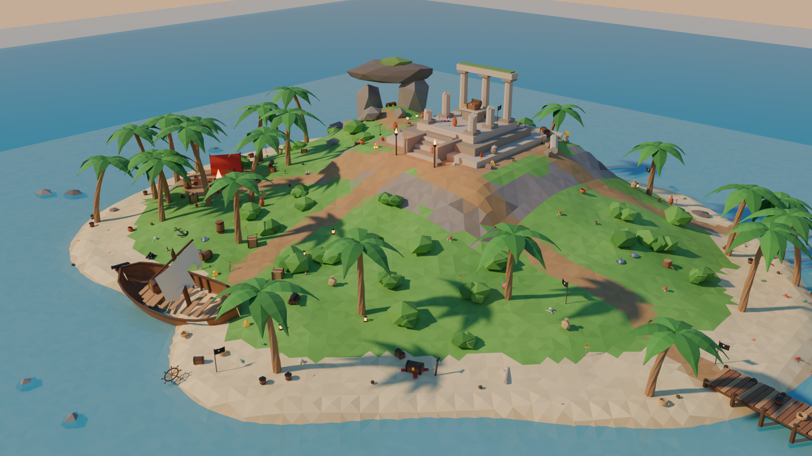
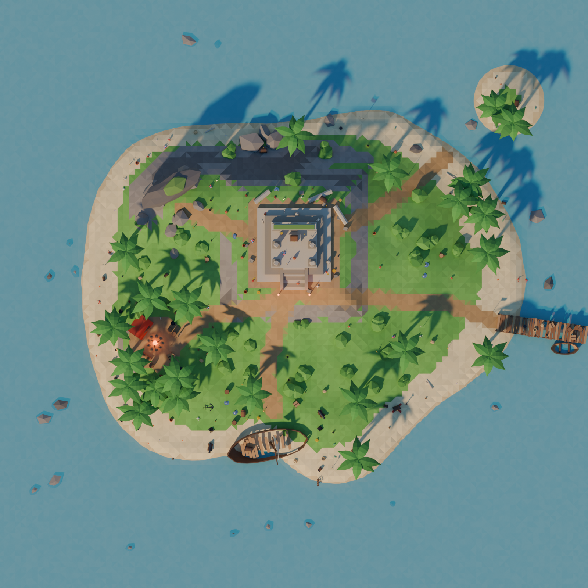
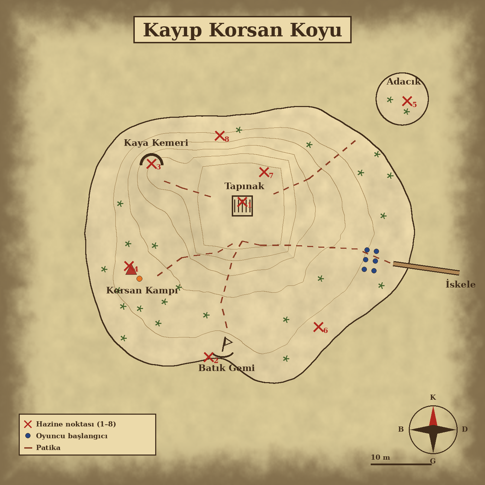
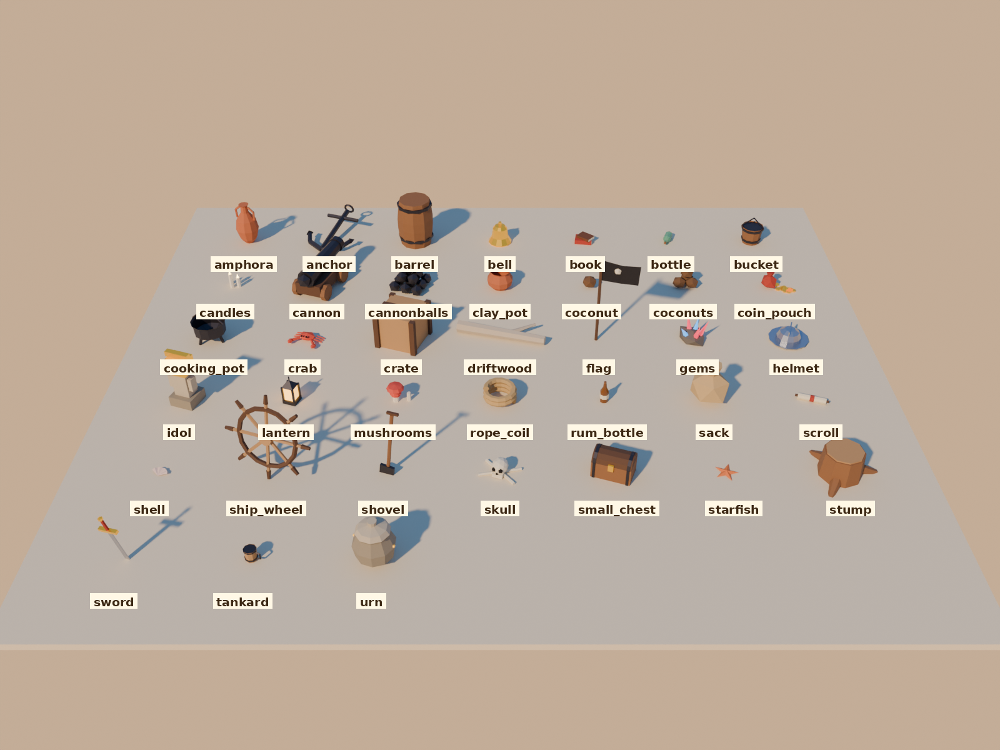

# Kayıp Korsan Koyu — SeekThenHide

Hazine avı için küçük bir harita: yaklaşık 55 m genişliğinde tropik bir ada. Low-poly,
düz gölgeli (flat shaded) stil. Her şey `build_treasure_cove.py` ile Blender içinde üretilir.



| Tepeden | Hazine haritası |
| --- | --- |
|  |  |

## Dosyalar

| Dosya | Ne işe yarar |
| --- | --- |
| `export/treasure_cove.glb` | Oyuna atılacak dosya (arazi, yapılar, bitki örtüsü, spawn noktaları) |
| `treasure_cove.blend` | Düzenlenebilir sahne; ışıklar ve kameralar `Preview_Rig` koleksiyonunda |
| `renders/treasure_map.png` | Parşömen tarzı yerleşim haritası (numaralı hazine noktaları, patikalar) |
| `renders/treasure_props_map.png` | Aynı harita, 200 eşyanın yerleriyle |
| `renders/props_catalog.png` | Bütün eşya çeşitleri yan yana, isimleriyle |
| `renders/cove_*.png` | Önizlemeler: genel görünüm, tapınak, tepeden |

## Ada

Oyuncular doğudaki **iskeleden** başlar; patikalar iskeleden, kamptan ve batık gemiden
tepedeki tapınakta birleşir.

- **Tapınak (merkez tepe):** üç katlı taş platform, güneyde merdiven ve iki meşale, arka
  sırada lento taşıyan üç sütun, önde kırık sütunlar, ortada sunak. Arkasında devrik
  sütunlar ve dağınık taşlar.
- **Batık gemi (güney koyu):** kumsala oturmuş, yatık bir korsan gemisi; gövdesinde yarık,
  kırık güverte, yırtık yelkenli kırık direk. Kumsalda dağılmış fıçı ve sandıklar.
- **İskele (doğu):** 11 m uzunluğunda, iki tahtası eksik ahşap iskele ve bağlı bir sandal.
- **Kaya kemeri (kuzeybatı tepesi):** iki kaya sütun ve üstünde yosunlu bir taş; altı küçük
  bir mağara gibi saklanmaya uygun.
- **Korsan kampı (batı palmiyeliği):** kırmızı yelken bezinden çadır, kamp ateşi, kütük
  banklar, fıçılar, sandıklar ve tapınağı gösteren bir tabela.
- **Adacık (kuzeydoğu açığı):** iki palmiyeli küçük bir kum adası. Ana adadan diz boyu
  (-0,45 m) bir kum seti üzerinden yürünerek gidilir.
- Saklanmak için iki düzine kadar palmiye, ~25 çalı ve ~25 kaya; kuzey kumsalında arkasına saklanılabilecek
  büyük kayalar.

## Hazine noktaları

Her `TreasureSpawn_##` boş nesnesinin altında bir `TreasureChest_##` sandığı vardır. Oyun
her turda birini (ya da birkaçını) açık bırakıp gerisini gizleyebilir.

| # | Yer | Not |
| --- | --- | --- |
| 1 | Tapınak sunağı | Açık kapaklı sandık, altın yığını |
| 2 | Batık gemi güvertesi | Yarığın yanında |
| 3 | Kaya kemerinin altı | Yanında birkaç altın |
| 4 | Korsan kampı çadırı | Çadırın içinde |
| 5 | Adacık | Palmiyelerin altında |
| 6 | Güneydoğu kumsalı | Kırmızı **X** işaretinin üstünde, yarı gömülü; yanında kürek |
| 7 | Tapınağın arkası | Devrik sütunların arasında |
| 8 | Kuzey kumsalı | Büyük kayaların arasında |

`PlayerSpawn_01..06` iskelenin kumsal ucunda, iki sıra hâlinde, yüzleri adaya dönük.

## Hazine olabilecek 200 eşya

Adaya, her biri ayrı bir nesne olan 200 eşya (`Prop_001_<çeşit>` … `Prop_200_<çeşit>`)
dağıtıldı; oyun hazineyi bunlardan herhangi birinin içine/altına saklayabilir. 38 çeşit var
ve her bölgeye oraya yakışan eşyalar düşer:



| Bölge | Adet | Eşyalar |
| --- | --- | --- |
| Kumsal | 44 | deniz kabuğu, deniz yıldızı, şişede mektup, hindistan cevizi, yengeç, dalgaya vurmuş kütük, kova, halat, küçük sandık, korsan bayrağı |
| Palmiye altları | 22 | hindistan cevizi (tek / yığın), çuval, kova |
| Tapınak | 30 | amfora, taş küp, kil çömlek, altın başlı put, kafatası, mücevher kümesi, mumlar, kitap, parşömen, çan, miğfer, kılıç, kese |
| Korsan kampı | 20 | fıçı, sandık kasa, çuval, fener, kova, rom şişesi, kazan, halat, kese, parşömen, kitap, küçük sandık, kürek, maşrapa |
| Batık gemi çevresi | 20 | gülle yığını, çapa, dümen, top, fıçı, kasa, rom şişesi, şişe, miğfer, kılıç, halat, çan, fener |
| Kaya kemeri | 12 | kafatası, fener, mücevher, mantarlar, mumlar, çömlek, kılıç, kese |
| İskele | 6 | kasa, fıçı, halat, kova, fener, çuval |
| Adacık | 5 | hindistan cevizi, kabuk, şişe, deniz yıldızı |
| İç kesim | 41 | mantarlar, kütük, çuval, çömlek, kürek, kılıç, miğfer, fener, kafatası, mücevher, küçük sandık, bayrak, amfora… |

Eşyalar yapıların, ağaçların, kayaların, patikaların ve spawn noktalarının içine girmeyecek
şekilde yerleştirilir; tapınaktakiler platform katlarının üstüne oturur. Aynı çeşitteki
eşyalar tek bir mesh'i paylaşır (glb'de her şekil bir kez saklanır).

## Motor notları

- Birim metre, glTF'de +Y yukarı. Kuzey Blender'da +Y, glTF'de -Z.
- Boş nesnelerin glTF `extras` alanında `kind` (`treasure_spawn`, `player_spawn`),
  `index` ve hazine noktaları için `label` bulunur; sandıklarda `kind = treasure_chest`.
- Eşyalarda `kind = treasure_prop`, `item` (çeşit, ör. `barrel`, `coconut`), `zone` (bölge)
  ve `index` (1–200) vardır.
- `Terrain` renklerini köşe rengi (`COLOR_0`) olarak taşır; çarpışma için doğrudan
  kullanılabilir. `Water` yarı saydam bir düzlemdir (z = 0), `Seabed` ufka kadar uzanan
  derin deniz zeminidir; ikisinin de çarpışması kapatılmalı.
- Adanın dışı derin su (-3,5 m); oyuncuları tutmak için yaklaşık 36 m yarıçaplı görünmez
  bir sınır yeterli.
- Meşale ve kamp ateşi alevleri (`M_Flame`, `M_FlameCore`) emissive; bloom açıkken en iyi görünür.

## Yeniden üretmek

```
blender --background --python build_treasure_cove.py
blender --background --python build_treasure_cove.py -- --fast
blender --background --python build_treasure_cove.py -- --no-render
```

Parşömen haritası için Pillow gerekir; yoksa o adım atlanır.
