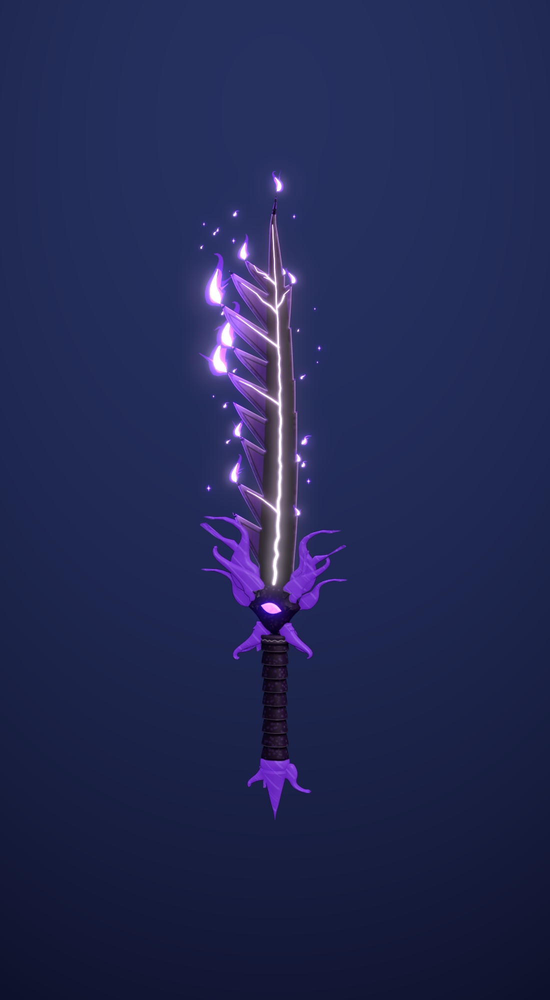

# Boşluk Hançeri — SeekThenHide

Mor hançerin, verilen referans hançerlerin (Kamish's Wrath, Baruka, Demon King,
Knight Killer) yapısı ve stiliyle yeniden tasarlanmış hali. Katanalarla aynı araç
setini (`../mystic_katana/build_mystic_katana.py`) kullanır; her şey
`build_void_dagger.py` ile Blender içinde üretilir.



## Dosyalar

| Dosya | Ne işe yarar |
| --- | --- |
| `export/void_dagger.glb` | Oyuna atılacak dosya (dokular gömülü, `ShadowFlameLoop` animasyonu) |
| `void_dagger.blend` | Düzenlenebilir sahne; dokular dosyanın içine paketli |
| `textures/` | Namlu (iki yüz yan yana, 1024×2048) ve kabza atlası (1024²) |
| `renders/` | Önizlemeler, `dagger_shadow_loop.mp4` alev döngüsü videosu |

## Blender'da oynatma

`void_dagger.blend`'i açın, 3D görünümde **Z → Material Preview** (ya da bloom ile
**Rendered**) seçin, **Space**'e basın. 1–72 kare (24 fps) döngü.

## Tasarım

Kamish's Wrath'ın yapısı, mevcut mor hançerin renkleriyle.

- **Namlu:** dikensiz, geniş, hafif S kıvrımlı bir hançer namlusu; ama kenarları kusursuz
  bir CAD eğrisi değil: yavaş, elde dövülmüş gibi bir dalgalanma, keskin ağızda altı, sırtta
  üç rastgele çentik/yontuk ve konturun tamamında hafif el titremesi. Kısıtlı Delaunay ile
  üçgenlenir; kesit düz plaka, yalnızca kenarda bileme.
- **Doku:** ortada mürekkep çizgisiyle çevrili koyu oluk bandı, kenarlara doğru mordan lilaya
  geçiş, açık bileme şeridi; omurga boyunca parlayan bir damar ve kenarlara uzanan kolları.
- **Kabza:** referanslardaki gibi sapın üzerine inen kalın, dövme metal bir hilal muhafız:
  pürüzsüz kemeri namlunun dibine oturur, kolları sapın iki yanına sarkar. Kolların iç kenarı
  aşağı ve dışa eğik, farklı boyutlarda sivri diş, kanca, çatal ve kırık dişlere bölünür
  (Kamish'in diş dilinden esinli, özgün kontur); uçları sapa doğru içe kıvrılan boynuz
  uçlarıyla biter. Hilal boyunca parlayan mor bir mine çizgisi, ortada gözsüz sade köşeli
  bir blok, her parçanın altında
  kalın mürekkep kontur katmanı. Sap ejderha kuyruğu gibi pullu halkalar, sivri topuz.
- **Gölge alevi:** keskin ağızdan (ve sırttan daha seyrek) yukarı kıvrılan üç tonlu el
  çizimi alevler ve yükselip sönen kıvılcımlar. 6 çizim üçerli değişir
  (0,75 sn döngü); damar ve mine çizgisi yavaş nabızla parlar.

## Motor notları

Orijin sapın ortasında, glTF'de hançer +Y yönünde. `FX_ShadowFlame_*` ve
`Dagger_InkOutline` için gölge düşürmeyi kapatın; bloom açık olursa en iyi görünür.

## Yeniden üretmek

```
blender --background --python build_void_dagger.py
blender --background --python build_void_dagger.py -- --fast
```
