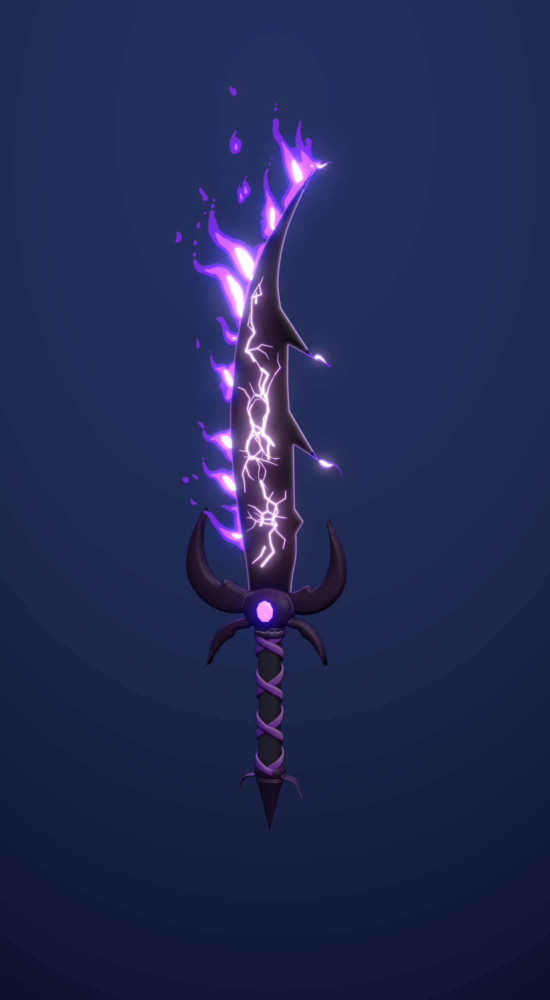

# Boşluk Hançeri — SeekThenHide

Mor hançerin, verilen referans hançerlerin (Kamish's Wrath, Baruka, Demon King,
Knight Killer) yapısı ve stiliyle yeniden tasarlanmış hali. Katanalarla aynı araç
setini (`../mystic_katana/build_mystic_katana.py`) kullanır; her şey
`build_void_dagger.py` ile Blender içinde üretilir.



## Dosyalar

| Dosya | Ne işe yarar |
| --- | --- |
| `export/void_dagger.glb` | Oyuna atılacak dosya (dokular gömülü, `ShadowFlameLoop` animasyonu) |
| `void_dagger.blend` | Düzenlenebilir sahne; dokular dosyanın içine paketli |
| `textures/` | Namlu (iki yüz yan yana, 1024×2048) ve kabza atlası (1024²) |
| `renders/` | Önizlemeler, `dagger_shadow_loop.mp4` alev döngüsü videosu |

## Blender'da oynatma

`void_dagger.blend`'i açın, 3D görünümde **Z → Material Preview** (ya da bloom ile
**Rendered**) seçin, **Space**'e basın. 1–72 kare (24 fps) döngü.

## Tasarım

- **Namlu:** referanslardaki gibi ağır, hilal gibi sırt tarafına kıvrılan, dışbükey keskin
  ağızlı bir namlu; sırtta geriye bakan iki çengel ve bir kırıcı diş, sivri uç. Elle
  çizilen 2D konturdan kısıtlı Delaunay üçgenlemesiyle üretilir. Kesit, referanslardaki
  gibi ince düz bir plaka; yalnızca kenardaki dar bileme şeridinde incelir (ortası
  şişkin değil). Çengeller ve dişler gerçek geometri.
- **Doku:** obsidyen-mor gövde, açık lila iki tonlu bileme şeridi ve koyu mürekkep
  çizgisi, namlu boyunca dallanan parlayan mor boşluk çatlakları (oyma + emission).
- **Kabza:** kalın, kalkan biçimli bir gövde ve her yanda kalın, yuvarlak kenarlı orak
  kanatlar: namluya doğru kıvrılan büyük bir kanat (keskin ağız tarafında daha büyük)
  ve sapa doğru inen kısa bir kanca. Gövdenin iki yüzünde parlayan mor taş; ince sap
  üzerinde mor ipek çapraz sargı, pençeli sivri topuz, kalın mürekkep konturu.
- **Gölge alevi:** keskin ağız boyunca rastgele aralıklı, asimetrik üç tonlu (koyu mor /
  mor / lila) el çizimi alev kümeleri; çengellerin ve ucun arkasından kopan alev dilleri.
  6 çizim üçerli değişir (0,75 sn döngü); çatlaklar ve taş yavaş nabızla parlar.

## Motor notları

Orijin sapın ortasında, glTF'de hançer +Y yönünde. `FX_ShadowFlame_*` ve
`Dagger_InkOutline` için gölge düşürmeyi kapatın; bloom açık olursa en iyi görünür.

## Yeniden üretmek

```
blender --background --python build_void_dagger.py
blender --background --python build_void_dagger.py -- --fast
```
